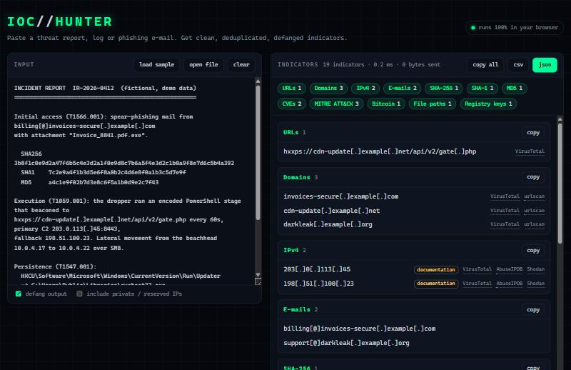

# IOC//HUNTER

**Paste a threat report, log or phishing e-mail and get clean, deduplicated, defanged indicators of compromise.** Everything runs in your browser. The page's own Content-Security-Policy makes it *impossible* for the code to send what you paste anywhere.

**▶ Live: [njuj.github.io/ioc-hunter](https://njuj.github.io/ioc-hunter/)**

[](https://github.com/njuj/ioc-hunter/actions/workflows/ci.yml)




## Features

- **12 indicator types:** URLs, domains, IPv4, e-mails, MD5 / SHA-1 / SHA-256, CVE IDs, MITRE ATT&CK technique IDs, Bitcoin addresses, Windows paths, registry keys
- **Refangs input** before extraction: `hxxps://`, `[.]`, `(.)`, `{.}`, `[dot]`, `[at]`, `(@)`, `[:]//`
- **Defangs output** (toggle) so indicators are safe to paste into tickets and chat
- **IPv4 scoping:** private, loopback, link-local, CGNAT and reserved ranges are hidden by default; documentation ranges (TEST-NET) are labelled
- **No false domains from filenames:** a real-TLD allow-list means `update.exe` and `gate.php` are never reported
- **Pivots:** one-click VirusTotal, AbuseIPDB, Shodan, urlscan, NVD and MITRE lookups per indicator
- **Export** to JSON or CSV, copy per category or everything at once
- Drag-and-drop `.txt` / `.log` / `.eml` files

## Security model

This tool parses hostile input by design, so it is built to be safe to point at anything:

| Threat | Mitigation |
|---|---|
| Pasted data being exfiltrated | CSP `connect-src 'none'`: the browser blocks `fetch`, XHR, WebSocket and beacons from this origin (you can check in DevTools: `fetch()` fails) |
| XSS from a malicious report | Untrusted text is rendered **only** through DOM text nodes (`append`, `textContent`), never `innerHTML`. CSP also forbids inline scripts and styles |
| CSV / formula injection in exports | Cells starting with `= + - @` are prefixed with `'`, so Excel and Sheets never execute them |
| Referrer leakage on lookups | `<meta name="referrer" content="no-referrer">` + `rel="noopener noreferrer"` |
| Supply chain | No dependencies, no build step, no CDN. What's in the repo is exactly what runs |

## Run it

It is a static site, so there is nothing to install:

```bash
git clone https://github.com/njuj/ioc-hunter && cd ioc-hunter
python -m http.server 8000      # or any static server → http://localhost:8000
npm test                        # node:test, no dependencies
```

(Opening `index.html` from disk doesn't work: browsers refuse ES modules over `file://`.)

## Architecture

```
index.html        markup + CSP
style.css         theme
src/extract.js    pure extraction / refang / defang / export logic (no DOM: runs in Node and the browser)
src/app.js        DOM wiring: rendering via text nodes, clipboard, downloads, drag & drop
src/sample.js     fictional incident report (reserved domains, TEST-NET IPs, BIP-173 example address)
test/             node:test suite for extract.js
```

Keeping `extract.js` free of DOM code means the exact module that ships to the browser is the one under test.

## Roadmap

- [ ] IPv6 and CIDR ranges
- [ ] STIX 2.1 bundle export
- [ ] Allow-list to suppress your own domains and IP ranges
- [ ] Highlight matches inside the input

---

<sub>built by <a href="https://github.com/njuj">kira</a> · trust nothing, verify everything</sub>
