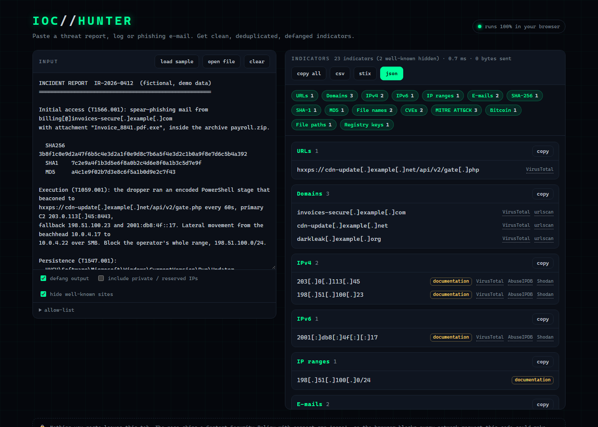

# IOC//HUNTER

[](https://github.com/cryptid-security)

**Paste a threat report, log or phishing e-mail and get clean, deduplicated, defanged indicators of compromise, ready for your tickets, CSV or a STIX 2.1 bundle.** Everything runs in your browser. The page's own Content-Security-Policy makes it *impossible* for the code to send what you paste anywhere.

On **158 real ESET threat reports** it finds 100% of the hashes, domains, IPs and URLs the vendor published as indicators. v0.1 found 66% of the URLs. On 11 MB of Python source code, where a "domain" is almost always code, it reports 26% fewer than v0.1 (details under [Accuracy](#accuracy-on-real-reports)).

**▶ Live: [njuj.github.io/ioc-hunter](https://njuj.github.io/ioc-hunter/)** · [with the demo report loaded](https://njuj.github.io/ioc-hunter/#demo)

[](https://github.com/njuj/ioc-hunter/actions/workflows/ci.yml)


<p align="center"></p>



## Features

- **16 indicator types:** URLs, domains, IPv4, IPv6, IP ranges (CIDR), e-mails, MD5 / SHA-1 / SHA-256 / SHA-512, file names, CVE IDs, MITRE ATT&CK technique IDs, Bitcoin addresses, Windows paths, registry keys
- **Refangs input** before extraction: `hxxps://`, `[.]`, `(.)`, `{.}`, `[dot]`, `[at]`, `(@)`, `[:]//`, also when a report's markup wraps them: AsciiDoc `++[++.++]++` and `` `+...+` ``, Markdown `\[.\]`
- **Every real TLD, without the noise:** a name the author defanged, or the host of a URL or e-mail, may end in any of the 1,436 TLDs in the IANA root zone (`.ms`, `.nu`, `.bond`, `.xn--6frz82g`). Undefanged text needs a TLD that indicators really use, so code like `self.name` or `m.group(1)` is not reported as a domain
- **File names vs domains:** `.zip`, `.mov`, `.py`, `.sh` are TLDs too. `invoice.zip` is a file, while `invoice[.]zip` and `cdn.evil.zip` are domains
- **Detection names are not domains:** `Win64/Agent.BT` and `Linux/SSHDoor.CA` sit in every vendor table, and `.bt` and `.ca` are real TLDs
- **Well-known sites hidden** (toggle): the reference links in a report's footnotes (MITRE, NVD, vendor blogs) are left out. Platforms attackers host on (GitHub, Google, Twitter, Telegram) hide only their bare home page, so `github.com/evil/loader` or a Google search URL used as a dead drop stays in. Anything the author defanged is always kept
- **Allow-list** your own domains, IPs and IPv4 ranges so they never show up; it is saved in this browser only
- **IP scoping:** private, loopback, link-local, CGNAT, unique-local and reserved ranges (v4 and v6) are hidden by default; documentation ranges are labelled
- **Pivots:** one-click VirusTotal, AbuseIPDB, Shodan, urlscan, NVD and MITRE lookups per indicator
- **Export** to a STIX 2.1 bundle (MISP, OpenCTI and most TIPs import it), JSON or CSV, or copy per category or everything at once
- Drag-and-drop `.txt` / `.log` / `.eml` / `.md` / `.adoc` files

## Security model

This tool parses hostile input by design, so it is built to be safe to point at anything:

| Threat | Mitigation |
|---|---|
| Pasted data being exfiltrated | CSP `connect-src 'none'`: the browser blocks `fetch`, XHR, WebSocket and beacons from this origin (you can check in DevTools: `fetch()` fails) |
| XSS from a malicious report | Untrusted text is rendered **only** through DOM text nodes (`append`, `textContent`), never `innerHTML`. CSP also forbids inline scripts and styles |
| CSV / formula injection in exports | Cells starting with `= + - @` are prefixed with `'`, so Excel and Sheets never execute them |
| Allow-list | Kept in `localStorage` of this page only; it never leaves the browser either |
| Referrer leakage on lookups | `<meta name="referrer" content="no-referrer">` + `rel="noopener noreferrer"` |
| Supply chain | No dependencies, no build step, no CDN. What's in the repo is exactly what runs |

## Accuracy on real reports

ESET publishes its threat research indicators at [github.com/eset/malware-ioc](https://github.com/eset/malware-ioc): 158 reports written in AsciiDoc, each with separate `samples.md5/sha1/sha256` files, and with every network indicator defanged by hand. That gives ground truth that does not come from ioc-hunter: the hash files, and every token ESET defanged with `[.]`.

| ESET reports (158) | v0.1 | v0.2 |
|---|---|---|
| hashes (4,900) | 100% | **100%** |
| domains (1,152) | 90.6% | **100%** |
| IPs (958) | 95.1% | **100%** |
| URLs (343) | 65.6% | **100%** |

The misses of v0.1 were AsciiDoc markup around the defang brackets (`38.54.57++[++.++]++17`), TLDs missing from its short list (`.ms`, `.nu`, `.lat`), and underscores in host names (`dl_dir.qq.com`). Three things the new rules first got wrong also came from these reports, and are now tests:
- a defanged Twitter account used as C2 that the well-known filter hid
- `totokupdate.ai` read as an Illustrator file
- a Google search URL used as a dead drop

Precision is checked the other way round, on text with no indicators: the 630 `.py` files of Python 3.12's standard library (11 MB). The full TLD list alone took the domains reported there from 505 to 1,301 (`self.name`, `f.read`). The plain-text TLD rule and the code guards bring it to **372, below v0.1**; most of what is left are real sites named in comments (`bugs.python.org`, `freebsd.org`). Every domain v0.1 reported on the ESET set that v0.2 drops is a detection name (`Win32/Korplug.RU`), a file path or a folder inside a URL.

```bash
git clone --depth 1 https://github.com/eset/malware-ioc ../eset
node scripts/eset-eval.mjs src/extract.js ../eset --show
```

The STIX export is checked in CI by the OASIS reference validator, `stix2_validator --strict`, on a bundle with every object type ioc-hunter writes (`scripts/stix-bundle.mjs`).

## Run it

It is a static site, so there is nothing to install:

```bash
git clone https://github.com/njuj/ioc-hunter && cd ioc-hunter
python -m http.server 8000      # or any static server → http://localhost:8000
npm test                        # node:test, no dependencies
```

(Opening `index.html` from disk doesn't work: browsers refuse ES modules over `file://`.)

## Architecture

```
index.html        markup + CSP
style.css         theme
src/extract.js    pure extraction / refang / defang / STIX + CSV + JSON export (no DOM: runs in Node and the browser)
src/tlds.js       the IANA root zone TLD list (regenerate command inside)
src/app.js        DOM wiring: rendering via text nodes, clipboard, downloads, drag & drop
src/sample.js     fictional incident report (reserved domains, TEST-NET IPs, BIP-173 example address)
test/             node:test suite for extract.js, including cases taken from real reports
scripts/          eset-eval.mjs (accuracy on ESET's reports), stix-bundle.mjs (input for the STIX validator)
```

Keeping `extract.js` free of DOM code means the exact module that ships to the browser is the one under test.

## Roadmap

- [x] IPv6 and CIDR ranges
- [x] STIX 2.1 bundle export
- [x] Allow-list to suppress your own domains and IP ranges
- [ ] Highlight matches inside the input
- [ ] IPv6 ranges in the allow-list

---

<sub>built by <a href="https://github.com/njuj">kira</a> · trust nothing, verify everything</sub>
